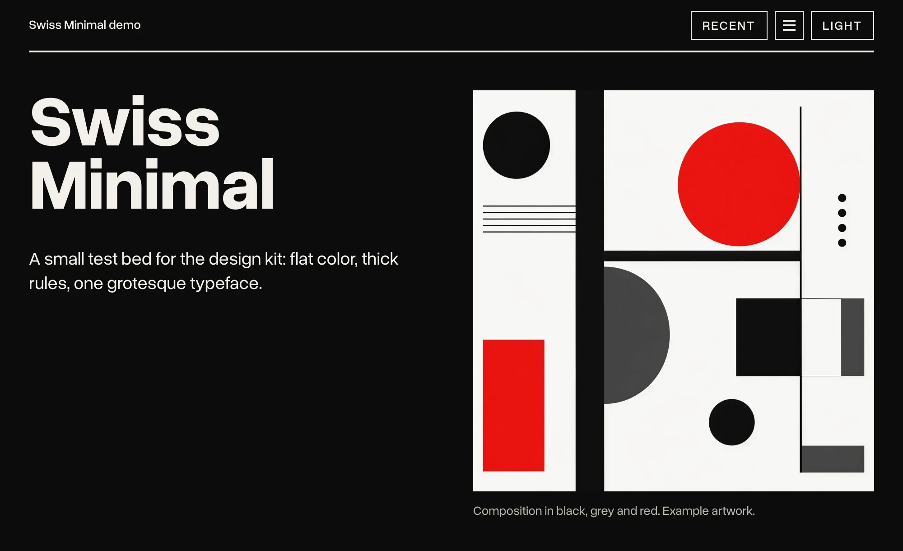

# Swiss Minimal



A Swiss / Bauhaus design kit for Astro and Tailwind v4: type-led, flat color, thick rules, one typeface.

Each site picks one accent: vermilion (the default, a red leaning toward orange) or verdigris (the blue-green of copper patina), with `<BaseLayout accent="vermilion">` / `accent="verdigris"`, or `<html data-accent="vermilion">` / `"verdigris"`. See Color in [`DESIGN.md`](DESIGN.md). In the demo, the gear on the right edge previews both.

- [`DESIGN.md`](DESIGN.md): the rules (color, type, layout, images, motion, accessibility, Tailwind setup).
- [`COMPONENTS.md`](COMPONENTS.md): markup and rules for each component.
- [`TOOLING.md`](TOOLING.md): recipes for accessibility tests (Playwright and axe) and date-tagged releases, and a manual checklist.
- [`AGENTS.md`](AGENTS.md): notes for AI agents (also `CLAUDE.md`): working on this repository, starting a new site with the kit, and restyling an existing one.
- [`kit/`](kit): `tailwind.css`, `theme.css`, small plain scripts (`panel.js`, `new-dot.js`, `drawer.js`, `jump.js`, `marquee.js`, `file-pick.js`, `output.js`, `dialog.js`, `favorites.js`, `icon-controls.js`) and the Astro components.
- [`fonts/`](fonts): Overused Grotesk, and Source Code Pro for code (both SIL OFL 1.1).
- [`demo/`](demo): a small Astro site that uses every component.

## Run the demo

Needs Node 22.12 or later (`demo/.nvmrc` pins 24).

```bash
cd demo
nvm use
npm install
npm run dev
```

## Test the demo

Builds the demo and scans every page, the menu tabs and the drawer for WCAG 2.1 AA problems in light and dark. See [`TOOLING.md`](TOOLING.md).

```bash
cd demo
npx playwright install chromium
npm test
```

## Releases

Each release is a date tag on main (`v2026.10.19`, or `v2026.10.19.2` for a second that day) with a GitHub Release whose notes come from the demo's Features list (`demo/src/data/features.ts`). From `demo/`:

```bash
npm run release -- --dry-run
```

```bash
npm run release
```

The dry run shows the tag and notes and changes nothing. The real run asks first, then runs the tests, pushes main, pushes the tag and publishes the release. It only runs on a clean, up-to-date main, and stops if a new feature isn't dated today. Before releasing something a visitor would notice, add it at the top of `features.ts`. The script is Dial Hopping's, adapted; see "Releases" in [`TOOLING.md`](TOOLING.md).
